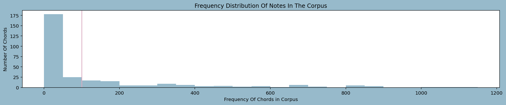
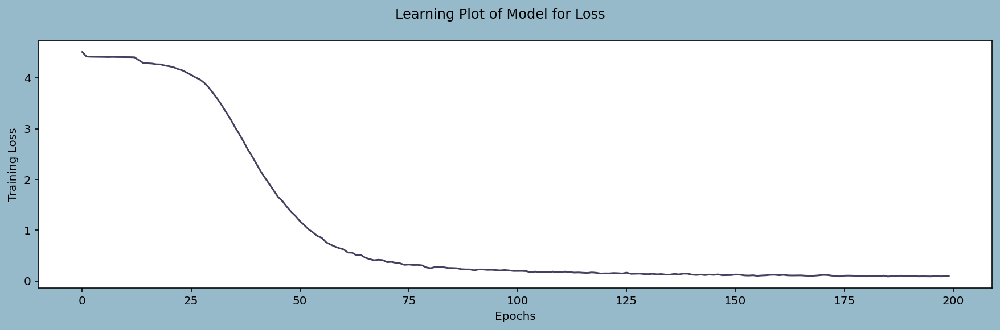

# Music-Generation-with-LSTM
Music generation with LSTM

[Koda açıklamalar ile beraber erişmek için](Music%20Generation%20with%20LSTM.ipynb)
<br>
[Sadece koda erişmek için](main.py)

Bu çalışmadaki amacım, ön işlemesini yaptığım piyano verileriyle eğittiğim ve **LSTM** katmanı içeren modelimin kendi başına yeni bir melodi üretebilmesiydi.

Modeli oluştururken *tensorflow*'dan, müzik dosyalarıyla çalışırken ise *music21* paketinden faydalandım.

## VERİ SETİ

MIDI dosyaları, bize sanatçıların şarkılar için yazdığı akorları ve melodileri sunan *.mid* uzantılı dosyalardır. Bir ses kaydı değil, hangi notanın ne zaman çalınacağını tutan bir nota kaydı gibi düşünebiliriz.

Modelimi [BeethovenMidiFiles](BeethovenMidiFiles) klasöründe bulunan, Beethoven'a ait 9 farklı eserin MIDI dosyası ile eğittim:

- beethoven-minuet-in-G.mid
- Beethoven-Moonlight-Sonata.mid
- Beethoven-Opus-57.mid
- beethoven-piano-sonata-pathetique-2.mid
- Beethoven-Pour-Piano.mid
- beethoven-sonata17.mid
- beethoven-sonata23.mid
- beethoven-symphony9-4-ode-to-joy-piano-solo.mid
- Beethoven-violin-sonata1-1-piano.mid

Aşağıdaki döngü sayesinde klasördeki uzantısı sadece *.mid* ile biten dosyaları çekiyorum. *tr* isimli geçici değişkende şarkının asıl path'ini tutuyorum, music21 paketinden gelen `converter.parse` ile dosyayı okuyorum ve *all_midis* ismini verdiğim listeye ekliyorum.

```
filepath = "BeethovenMidiFiles/"

all_midis= []
for i in os.listdir(filepath):
    if i.endswith(".mid"):
        tr = filepath+i
        midi = converter.parse(tr)
        all_midis.append(midi)
```

## VERİNİN İNCELENMESİ

MIDI dosyaları notaları ve akorları beraber tutarlar. Notalar bildiğimiz üzere *C, D, E, F, G, A, B* şeklinde *do, re, mi, fa, sol, la, si*'ye karşılık gelir. Yanlarındaki sayı ise notanın hangi oktavda olduğunu gösterir, yani *G2* ikinci oktavdaki sol notasıdır. *G#* gibi ifadeler ise diyez notaları temsil eder.

Akorlar ise aynı anda çalınan birden fazla notanın oluşturduğu ses kümeleridir diyebiliriz. music21 akorları notaların sayısal karşılıklarıyla tutar (0 = C, 1 = C#, 2 = D, ... 11 = B). Örneğin *7.11* aynı anda çalınan sol ve si notalarından oluşan bir akordur.

Her şarkıdaki notaları ve akorları çıkarmak için aşağıdaki fonksiyonu yazdım:

```
def extract_notes(file):
    notes = []
    pick = None
    for j in file:
        songs = instrument.partitionByInstrument(j)
        for part in songs.parts:
            pick = part.recurse()
            for element in pick:
                if isinstance(element, note.Note):
                    notes.append(str(element.pitch))
                elif isinstance(element, chord.Chord):
                    notes.append(".".join(str(n) for n in element.normalOrder))

    return notes
```

Çıkarılan notaları *Corpus* isimli değişkende tutuyoruz. Artık ilgileneceğimiz veriler bu değişkende.

```
Corpus= extract_notes(all_midis)
print("Total notes in all the Beethoven midis in the dataset:", len(Corpus))
print("First fifty values in the Corpus:", Corpus[:50])
```

Çıktım şu şekilde:

```
Total notes in all the Beethoven midis in the dataset: 39325
First fifty values in the Corpus: ['7.11', '9.0', '11.2', 'G2', '10.1', '11.2', 'B2', '10.1', '11.2', 'D3', ...]
```

Yani 9 eserde toplam **39.325** nota ve akor var. Bunların içinde birbirinden farklı olanların sayısı ise **293**.

## VERİ ÖN İŞLEME

Bazı notalar sıklıkla görülürken bazıları çok az görülmektedir. Çok az görülen notalar yeni üreteceğimiz melodinin yapısını bozabilir. Bu yüzden önce notaların görülme sıklıklarına bakıyoruz.

```
Notes = list(count_num.keys())
Recurrence = list(count_num.values())

def Average(lst):
    return sum(lst) / len(lst)
print("Average recurrenc for a note in Corpus:", Average(Recurrence))
print("Most frequent note in Corpus appeared:", max(Recurrence), "times")
print("Least frequent note in Corpus appeared:", min(Recurrence), "time")
```

| | Değer |
|---|---|
| Bir notanın ortalama görülme sayısı | 134,2 |
| En sık görülen notanın görülme sayısı | 1189 |
| En az görülen notanın görülme sayısı | 1 |

Bu dağılımı bir histogram ile görselleştirdiğimizde çıktım şu şekilde:



Grafikte görüldüğü üzere notaların büyük çoğunluğu 50'den az görülüyor. Pembe çizgi 100 sınırını gösteriyor. Bu sınırın altında kalan notaları *rare_note* isimli listede tutuyoruz ki sonra bunları eleyelim.

```
rare_note = []
for index, (key, value) in enumerate(count_num.items()):
    if value < 100:
        m =  key
        rare_note.append(m)
        
print("Total number of notes that occur less than 100 times:", len(rare_note))
```

100'den az görülen **203** nota var. `remove()` fonksiyonu ile bu notaları Corpus'tan temizliyoruz.

```
for element in Corpus:
    if element in rare_note:
        Corpus.remove(element)

print("Length of Corpus after elemination the rare notes:", len(Corpus))
```

Bu işlemden sonra Corpus'un uzunluğu **36.395**'e düştü.

### Notaların Sayısallaştırılması

Model notaları değil sayıları anlayabildiği için her notaya bir sayı atıyoruz. *mapping* sözlüğü notadan sayıya, *reverse_mapping* ise sayıdan notaya çeviri yapmamızı sağlıyor. Bu sayede model bir sayı tahmin ettiğinde onu tekrar notaya çevirebileceğiz.

```
# Storing all the unique characters present in my corpus to bult a mapping dic. 
symb = sorted(list(set(Corpus)))

L_corpus = len(Corpus) #length of corpus
L_symb = len(symb) #length of total unique characters

#Building dictionary to access the vocabulary from indices and vice versa
mapping = dict((c, i) for i, c in enumerate(symb))
reverse_mapping = dict((i, c) for i, c in enumerate(symb))

print("Total number of characters:", L_corpus)
print("Number of unique characters:", L_symb)
```

Çıktıya göre Corpus'ta **243** farklı nota kaldı.

### Dizilerin Oluşturulması

LSTM'in mantığı, bir dizideki önceki adımlara bakarak bir sonraki adımı tahmin etmektir. Bu yüzden Corpus'u 40 notalık parçalara bölüyoruz. Her parçanın hemen ardından gelen nota ise modelin tahmin etmesi gereken hedef oluyor. Yani model 40 notayı dinliyor ve 41. notanın ne olacağını tahmin etmeye çalışıyor.

```
#Splitting the Corpus in equal length of strings and output target
length = 40
features = []
targets = []
for i in range(0, L_corpus - length, 1):
    feature = Corpus[i:i + length]
    target = Corpus[i + length]
    features.append([mapping[j] for j in feature])
    targets.append(mapping[target])
    
    
L_datapoints = len(targets)
print("Total number of sequences in the Corpus:", L_datapoints)
```

Bu şekilde toplam **36.355** dizi elde ettik.

Son olarak girdileri 0 ile 1 arasına normalize ediyoruz ve hedefleri one hot encoding ile kodluyoruz. Verinin %20'sini ise daha sonra melodi üretirken başlangıç noktası (seed) olarak kullanmak için ayırıyoruz.

```
# reshape X and normalize
X = (np.reshape(features, (L_datapoints, length, 1)))/ float(L_symb)
# one hot encode the output variable
y = tensorflow.keras.utils.to_categorical(targets) 

#Taking out a subset of data to be used as seed
X_train, X_seed, y_train, y_seed = train_test_split(X, y, test_size=0.2, random_state=42)
```

## MODELİN OLUŞTURULMASI

Modelimde art arda iki LSTM katmanı kullandım. Aralarındaki Dropout katmanları, eğitim sırasında nöronların bir kısmını rastgele devre dışı bırakarak ezberlemeyi azaltmaya yardımcı olur. Son katmandaki nöron sayısı, Corpus'taki farklı nota sayısı olan 243'e eşit. Çünkü model her adımda bu 243 notadan hangisinin geleceğini tahmin ediyor.

```
#Initialising the Model
model = Sequential()
#Adding layers
model.add(LSTM(512, input_shape=(X.shape[1], X.shape[2]), return_sequences=True))
model.add(Dropout(0.1))
model.add(LSTM(256))
model.add(Dense(256))
model.add(Dropout(0.1))
model.add(Dense(y.shape[1], activation='softmax'))
#Compiling the model for training  
opt = Adamax(learning_rate=0.01)
model.compile(loss='categorical_crossentropy', optimizer=opt)
model.summary()
```

Çıktım şu şekilde:

| Katman | Çıktı Boyutu | Parametre Sayısı |
|---|---|---|
| lstm (LSTM) | (None, 40, 512) | 1.052.672 |
| dropout (Dropout) | (None, 40, 512) | 0 |
| lstm_1 (LSTM) | (None, 256) | 787.456 |
| dense (Dense) | (None, 256) | 65.792 |
| dropout_1 (Dropout) | (None, 256) | 0 |
| dense_1 (Dense) | (None, 243) | 62.451 |
| **Toplam** | | **1.968.371** |

## MODELİN EĞİTİLMESİ

Modelimizi 200 epoch boyunca eğitiyoruz.

```
history = model.fit(X_train, y_train, batch_size=256, epochs=200)
```

Eğitim sırasında loss değerinin nasıl değiştiğini görselleştirelim.

```
#Plotting the learnings 
history_df = pd.DataFrame(history.history)
fig = plt.figure(figsize=(15,4), facecolor="#97BACB")
fig.suptitle("Learning Plot of Model for Loss")
pl=sns.lineplot(data=history_df["loss"],color="#444160")
pl.set(ylabel ="Training Loss")
pl.set(xlabel ="Epochs")
```

Çıktım şu şekilde:



İlk 25 epoch boyunca loss değeri 4,5 ile 4,0 arasında çok yavaş değişiyor. Model bu aşamada henüz bir örüntü yakalayamamış. 25. epoch'tan sonra hızla düşmeye başlıyor ve 100. epoch civarında 0,2'nin altına iniyor. Eğitim sonunda loss değeri **4,51**'den **0,09**'a düştü.

## MÜZİK ÜRETİMİ

Artık modelimizle yeni bir melodi üretebiliriz. *Malody_Generator* fonksiyonu, ayırdığımız seed verisinden rastgele bir 40 notalık dizi seçiyor ve modelden bir sonraki notayı tahmin etmesini istiyor. Tahmin edilen nota dizinin sonuna ekleniyor, en baştaki nota çıkarılıyor ve model bu yeni diziye bakarak tekrar tahmin yapıyor. Bu işlem istediğimiz nota sayısına ulaşana kadar devam ediyor.

```
def Malody_Generator(Note_Count):
    seed = X_seed[np.random.randint(0,len(X_seed)-1)]
    Music = ""
    Notes_Generated=[]
    for i in range(Note_Count):
        seed = seed.reshape(1,length,1)
        prediction = model.predict(seed, verbose=0)[0]
        prediction = np.log(prediction) / 1.0 #diversity
        exp_preds = np.exp(prediction)
        prediction = exp_preds / np.sum(exp_preds)
        index = np.argmax(prediction)
        index_N = index/ float(L_symb)   
        Notes_Generated.append(index)
        Music = [reverse_mapping[char] for char in Notes_Generated]
        seed = np.insert(seed[0],len(seed[0]),index_N)
        seed = seed[1:]
    #Now, we have music in form or a list of chords and notes and we want to be a midi file.
    Melody = chords_n_notes(Music)
    Melody_midi = stream.Stream(Melody)   
    return Music,Melody_midi
```

Modelin ürettiği notalar *reverse_mapping* ile tekrar nota isimlerine çevriliyor. *chords_n_notes* fonksiyonu ise bu nota ve akor listesini music21'in anlayabileceği bir müzik akışına dönüştürüyor.

```
def chords_n_notes(Snippet):
    Melody = []
    offset = 0 #Incremental
    for i in Snippet:
        #If it is chord
        if ("." in i or i.isdigit()):
            chord_notes = i.split(".") #Seperating the notes in chord
            notes = [] 
            for j in chord_notes:
                inst_note=int(j)
                note_snip = note.Note(inst_note)            
                notes.append(note_snip)
                chord_snip = chord.Chord(notes)
                chord_snip.offset = offset
                Melody.append(chord_snip)
        # pattern is a note
        else: 
            note_snip = note.Note(i)
            note_snip.offset = offset
            Melody.append(note_snip)
        # increase offset each iteration so that notes do not stack
        offset += 1
    Melody_midi = stream.Stream(Melody)   
    return Melody_midi
```

Son olarak 100 notalık bir melodi üretip MIDI dosyası olarak kaydediyoruz.

```
#getting the Notes and Melody created by the model
Music_notes, Melody = Malody_Generator(100)

#To save the generated melody
Melody.write('midi','Melody_Generated.mid')
```

## SONUÇLAR

Modelimin ürettiği melodi [Melody_Generated.mid](Melody_Generated.mid) dosyasında bulunuyor. GitHub MIDI dosyalarını tarayıcıda çalamadığı için dinlemek isterseniz dosyayı indirip herhangi bir müzik çalar ya da MIDI programı ile açabilirsiniz.

Bu projede bir sınıflandırma yapmadığımız için doğruluk oranı gibi bir metrik yok. Üretilen müziğin kalitesini değerlendirmenin en iyi yolu onu dinlemek. Loss değerinin 0,09'a kadar düşmesi modelin Beethoven eserlerindeki nota dizilerini çok iyi öğrendiğini gösteriyor. Ancak bu kadar düşük bir loss, modelin eğitim verisindeki dizileri büyük ölçüde ezberlemiş olabileceği anlamına da geliyor. Bu durumda üretilen melodi, eğitimde kullanılan eserlerden parçalara benzeyebilir.
